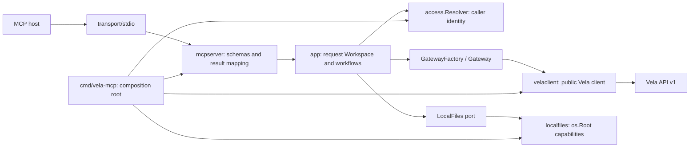

# Architecture and future OAuth integration

## Boundaries

| Package | Responsibility | Does not know about |
| --- | --- | --- |
| `cmd/vela-mcp` | Configuration, key/API verification, wiring, signal lifecycle | Individual tool workflows |
| `internal/config` | Strict TOML, environment precedence, defaults, validation | MCP sessions, networking, OAuth |
| `internal/catalog` | Single inventory of switches and risk defaults | Backend and transport |
| `internal/access` | Identity, redacted credential, Resolver, scopes/prefix | MCP, HTTP, databases |
| `internal/app` | Workflows, authority checks, file creation/transfer | MCP SDK, HTTP client, config, SQLite |
| `internal/velaclient` | Gateway implementation using the official Vela client | MCP and user authentication flows |
| `internal/localfiles` | Allowed roots, regular-file input, exclusive verified output | Vela credentials and transport |
| `internal/mcpserver` | Schemas, registration, annotations, results, guide resource | Static tokens, HTTP routing, identity persistence |
| `internal/transport/stdio` | MCP stdio lifecycle | Business workflows and authorization |

The application uses `go.xchunk.org/vela/api` as public value contracts. This is an intentional dependency on the versioned Vela API, not its HTTP implementation. Port options belong to the application, so `client.UploadOptions` and HTTP headers never enter workflows. The Vela client and MCP SDK are pinned in `go.mod`/`go.sum`; the runtime imports neither Vela internal packages nor its SQLite implementation. An architecture import test prevents business code from importing MCP, config, filesystem adapters, or the REST client.

## One invocation

1. The MCP SDK validates the input schema. Missing/disabled tools cannot execute.
2. The handler sets an overall timeout and calls `Service.Open(ctx)`.
3. `access.Resolver` resolves the caller identity **in this request context**.
4. `GatewayFactory` creates a client with that identity's credential. The service has no global backend key.
5. The workflow normalizes paths, checks scope/prefix, validates values, and calls ports.
6. Vela independently checks scope, paths, and revisions as the final data owner.
7. The handler returns structured output/JSON text or `isError=true` with a normalized error.

A Workspace lives only for one invocation. The static stdio Resolver receives scope/prefix after the startup `/info` check. Credential formatting is redacted and its token is not an exported serializable field. Startup logs go to stderr and include no arguments, contents, key secrets, or signed URLs. Network failures are normalized without diagnostic URLs; upstream API errors retain useful codes/details/request IDs.

Opaque-ID operations cannot bypass application authority: restore/purge bind trash IDs to authorized original paths, and revoke binds link IDs to authorized paths. Ancestor listings are narrowed to the identity's prefix before calling Vela. Root mutations and bulk purges require unrestricted admin. The Access Resolver is a trusted security boundary: it must return a verified, unexpired identity with authority no broader than its upstream key.

## Filesystem capabilities

An MCP client's roots are not treated as local-access authorization. Only host-configured roots are permitted. `os.Root` confines operations to opened directories and prevents symlink/traversal escapes. Linux uploads use `O_NONBLOCK` to avoid hanging on a raced-in FIFO; regular-file type is checked again on the open descriptor. Other platforms have a regular-file-check fallback; the Docker runtime is Linux.

Base64/text limits are checked before upload. A local source is hashed with its original size as a bound, then rewound. Server-side SHA-256 protects against changes during transfer. Creation uses `If-None-Match: *`; replacement requires `If-Match`. The upstream client produces metadata headers, including percent-encoded Unicode title/description. Text creation also uses the streaming endpoint: metadata and content commit together, and Vela's small inline JSON endpoint limit does not constrain this workflow.

Local output uses `O_EXCL`, mode `0600`, bounded copying, checksum verification, sync, and cleanup on failure. The tools do not create parent directories or overwrite local files. Timeout/cancellation reaches Vela and local streaming copies. Truncated reads do not claim to verify the full-file hash.

## Moving to HTTP and OAuth 2.1

The next stage must also support bidirectional binary transfer for cloud clients:
upload attachments into Vela, download any file into the client's computing
environment, process it there, and return it to the user. See the proposed
[HTTP file-transfer contract](http-file-transfer.md). This uses HTTP byte routes
alongside MCP control operations; it does not require base64 or shared filesystem
paths between the client and the server.

This prototype has **no** OAuth server, HTTP listener, or MCP SQLite persistence. It provides integration boundaries rather than a placeholder OAuth implementation.

For the next stage:

1. Add MCP Streamable HTTP transport. Its network adapter must validate Origin/Host, bound request bodies, manage session lifecycle, and propagate verified authentication through request context. Keep stdio as a separate launch option.
2. Add an `access.Resolver` that reads verified context and resolves subject/scopes/prefix and a Vela credential. Never derive authority from tool arguments, arbitrary headers, `_meta`, or an unverified JWT.
3. Define application-owned ports for clients, authorization codes, grants, refresh tokens, mappings, and credential lookup. Implement SQLite in a separate adapter; workflows and MCP handlers must not import SQL. The adapter owns migrations.
4. Implement OAuth 2.1 authorization/token/revocation endpoints and lifecycle, along with MCP-required discovery. Map OAuth permissions to Vela scope/prefix, ensuring effective authority never exceeds the upstream key. Do not give every user the authority of a shared unrestricted admin key.
5. Supply the same `mcpserver.New` with a Service using the new Resolver. Do not cache request identity in the server or shared session. Test revocation/expiry, client binding, cross-user isolation, and opaque-ID authorization separately.

Per-user Vela keys with matching scope/prefix are the most direct backend mapping. If a shared service credential becomes necessary, local authority narrowing and authorization of every opaque-ID operation are mandatory; the existing scoped bulk-purge restriction already closes one such escape. Never carry the static stdio identity from the composition root into an HTTP deployment.

Discovery details, grant flow, session storage, consent UI, and backend credential issuance need separate design in the next stage. Interfaces alone do not make an HTTP deployment secure: a verified Resolver and a complete OAuth lifecycle are required.
