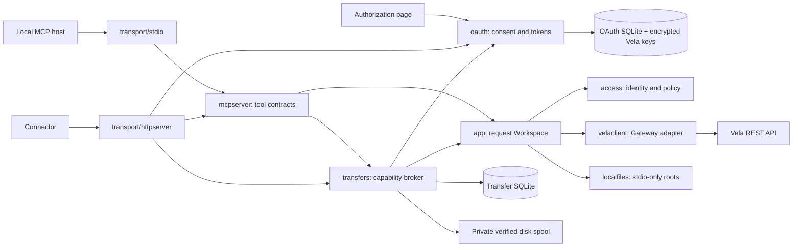

# Architecture

The executable selects stdio or HTTP at its composition root. Both transports use the same application workflows and request-scoped authority checks. OAuth and persistence are adapters; the business layer imports neither SQL nor the MCP SDK.

## Package boundaries

| Package | Responsibility |
| --- | --- |
| `cmd/vela-mcp` | Configuration, startup checks, adapter wiring, selected transport, signal lifecycle |
| `internal/config` | Strict TOML, environment precedence, defaults and validation |
| `internal/catalog` | Single tool inventory and risk defaults |
| `internal/access` | Redacted upstream credential, caller identity, request Resolver, scope/prefix policy |
| `internal/app` | Transport-independent workflows, validated stream contracts and authority checks |
| `internal/velaclient` | Application Gateway ports implemented with Vela's public Go client |
| `internal/localfiles` | Explicit filesystem roots, regular-file inputs, exclusive verified outputs |
| `internal/mcpserver` | Tool schemas, descriptions, annotations, result/error mapping and guide resource |
| `internal/oauth` | Authorization server, consent, client registration/metadata, token lifecycle, encrypted SQLite |
| `internal/transfers` | Scoped capability persistence, byte routes, bounded spooling and receipts |
| `internal/transport/httpserver` | Host/Origin policy, OAuth bearer middleware, MCP HTTP transport, routing/lifecycle |
| `internal/transport/stdio` | MCP stdio lifecycle |

`go.xchunk.org/vela/api` supplies the public value contracts. Application options belong to application ports; upstream HTTP headers and `client.UploadOptions` stay in the REST adapter. An import architecture test enforces this boundary. SQLite uses a pure-Go driver, so the image keeps a static executable with `CGO_ENABLED=0`.

## Request identity

`Service` owns dependencies; a `Workspace` owns the identity and Gateway for one invocation. The service has no shared administrator key. In stdio, a verified Vela key supplies a `Static` resolver for that process. HTTP uses a `ContextResolver` which accepts only identities placed in context by the trusted bearer adapter. Tool arguments, metadata and MCP session headers cannot select another identity.

On every HTTP request, OAuth checks the opaque access token and its active grant, decrypts that grant's Vela credential, and attaches its subject, Vela scope and path prefix to the request. MCP handlers resolve it again when opening a Workspace. Stateless Streamable HTTP sessions prevent a session from caching another user's identity. HTTP composition leaves the LocalFiles port unset and omits the local download tool.

The application normalizes paths, narrows ancestor listings, checks scope/prefix, validates values, and calls ports. Vela independently enforces the key's own rights and revisions. Opaque link/trash IDs are bound to accessible paths before mutation. Root policy changes and bulk purges require unrestricted admin authority. Disabled tools are absent from discovery and cannot run by name.

## OAuth storage and lifecycle

The local authorization server implements authorization code with mandatory S256 PKCE, redirect binding, the `/mcp` resource audience, rotating refresh tokens, and revocation. HTTPS callbacks match exactly; native loopback HTTP callbacks may vary only their port. The concrete callback is stored and matched exactly during token exchange. Only public clients with `token_endpoint_auth_method=none` are supported. Clients may use dynamic registration or an HTTPS client ID metadata document; a client name is self-asserted rather than an identity certificate. Public metadata fetching uses a separate, bounded HTTPS client that rejects private/reserved addresses and redirects.

Consent is bound to a short-lived browser transaction, cookie and CSRF token. Users enter a Vela API key; the server verifies `/info` before issuing a grant. The OAuth scope is `vela`; effective operations remain the entered key's actual `ro`, `rw` or `admin` authority and prefix. Each consent creates a distinct stable grant subject.

OAuth tokens, authorization codes and browser transaction secrets are hashed at rest. Vela credentials are encrypted with AES-GCM and a separate 32-byte key file; grant identity binds the encrypted value. Access tokens expire independently. Refresh rotation does not extend the grant's absolute lifetime. Refresh replay or token revocation revokes the entire grant, invalidating its access/refresh tokens and file capabilities. The database encryption sentinel rejects a missing/replaced key rather than silently generating unusable replacement state.

SQLite files and the key are private local files. This is credential encryption, not whole-database encryption: grant metadata remains visible to someone who can read the database. The key and database must be backed up together. No password account, hosted identity provider, JWT signing infrastructure or shared upstream token is involved.

## File boundaries

stdio roots are operator-supplied filesystem capabilities, not MCP client roots. `os.Root` confines access, including symlink/traversal escapes. Uploads accept regular files; local downloads use exclusive creation, mode `0600`, checksum verification, and cleanup. Parents must exist. Neither direction overwrites local files.

HTTP transfers bind one grant subject, normalized path/object version, size, hash and metadata. The transfer database stores capability hashes and a subject reference, never upstream credentials. Redemption rechecks the OAuth grant and creates a fresh Workspace with its identity and no LocalFiles port. Upload claims are atomic and single-use. Downloads allow bounded retries and ranges without changing visibility.

Both byte directions spool into private temporary files next to transfer storage. Copies have fixed byte bounds and constant RAM use. Full size/hash verification happens before a Vela mutation or response containing file bytes. Vela also checks upload hashes. Source metadata and checksum checks reject a download racing with replacement. Files are removed after use and stale spools are cleaned at startup; four concurrent transfers bound disk consumption. Interrupted upload claims become uncertain after restart; status can observe matching destination content without pretending that matching content proves the original request committed.

Creation uses conditional create-only uploads. `replace_file` is separately enabled and requires a revision; the HTTP upload broker cannot bypass this by replacing content. Relative creation expiry is fixed when a transfer is prepared. Download responses force attachment disposition, `nosniff` and a restrictive CSP so arbitrary uploaded HTML cannot execute alongside OAuth consent pages.

## HTTP and operational boundary

The configured issuer defines public URLs and the allowed host. Forwarding headers do not choose the issuer or establish caller identity. Protected browser requests require an explicitly allowed Origin; machine requests without Origin are accepted. Discovery, registration and token/revocation exchanges support public CORS without browser credentials. Request bodies, headers and timeouts are bounded. The reverse proxy owns HTTPS, external request limiting and access-log redaction.

Run one process per persistent state directory. SQLite durability supports restart/recovery, not shared-state active replicas. `/healthz` reports process availability only. Native conversation attachments and the client's outbound network permissions remain host responsibilities. See [deployment](deployment.md) and [file transfer](http-file-transfer.md) for the concrete routes and operating contract.
