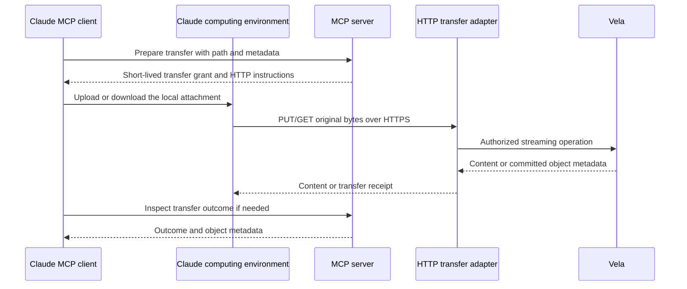

# HTTP file transfer for cloud MCP clients

Status: requirements and proposed contract for the next HTTP/OAuth stage. The
current executable remains stdio-only; the tools and routes proposed below are
not implemented. Existing `create_share_link` already returns a Vela signed
download URL, which a network-enabled client can download without a Vela key.

## Required workflows

- Upload a chat attachment or a file created in the client's computing environment
  to Vela, with all writable metadata applied during creation.
- Download any Vela file as its original bytes into the client's computing
  environment, including images, PDFs, Office documents, archives, audio, and
  arbitrary binary formats.
- Let the client process a downloaded file with available tools, then upload a
  resulting file through the same transfer workflow.
- Return a file to the user as a native conversation attachment when the host
  supports it, or as an expiring download link.

File transfer must preserve original bytes and support bounded streaming. Text
extraction, previews, and model interpretation are separate operations. `read_file`
continues to provide bounded conversation content; local `download_file` continues
to save into host-configured roots rather than the cloud client's filesystem.

## Control and byte transfer

MCP carries authorization requests, metadata, and receipts as JSON. Separate HTTP
routes carry binary bytes. Moving MCP itself to Streamable HTTP does not make
JSON tool calls into multipart uploads or provide a shared client filesystem.
Both HTTP adapters can run in the same process and Docker image. stdio remains
available independently of the MCP HTTP transport.

## Proposed upload contract

1. `prepare_file_upload` accepts a logical destination, writable metadata, byte
   size, and SHA-256. It authorizes the caller and binds these values to a transfer.
   New-file uploads remain create-only and default to private. Replacement stays
   a separately enabled operation with a required revision.
2. It returns `transfer_id`, `upload_url`, method `PUT`, a short-lived upload
   authorization header, expiry, and size limit. The client uses its code execution
   environment to send the actual file as a raw body; the model does not reproduce
   its base64 representation in a tool argument.
3. The HTTP adapter verifies the grant, claims the transfer atomically, enforces
   the bound size/checksum, and passes the stream into an application workflow.
   The workflow applies the already-authorized metadata and uses the caller's
   upstream credential. Completion returns the Vela object and a transfer receipt.
4. `get_file_transfer_status` lets the same authorized caller inspect success or
   failure after a lost response. A repeated upload must not become an unrestricted
   overwrite; retry behavior must follow recorded transfer state.

## Proposed download contract

1. `prepare_file_download` accepts a logical file path and authorizes read access.
   It returns filename, MIME type, size, SHA-256, and an expiring download URL or
   HTTP request instructions. The grant binds the authorized object identity and
   content version, rather than allowing the requester to substitute another path.
2. The client's computing environment downloads the bytes into its own filesystem
   and verifies the checksum. The same workflow handles all file types; processing
   depends on the tools and libraries available in that environment.
3. To return a file to the user, the client can attach the downloaded file through
   its native file-output mechanism. An expiring browser-usable link is the fallback
   for unsupported attachment types or host size limits.

A read-only caller must be able to obtain a download transfer without acquiring
Vela's `rw` scope. The transfer broker therefore cannot rely solely on Vela's
`create_share_link`, which requires `rw`. Public sharing and access revocation
remain separate business operations. Downloading a private file must not change
its visibility to public or unlisted.

## Authorization and boundaries

OAuth authenticates MCP control requests. Byte-transfer grants authorize one
specific operation and avoid exposing the long-lived Vela key or general OAuth
credential to generated shell commands. Upload grants are single-use; download
grants have explicitly bounded lifetime and usage, allowing deliberate retries or
range requests. A grant may not change its bound subject, destination/source,
metadata, revision, size, or checksum. Expired/revoked authority must not become
a new unrestricted transfer. Grant values and signed URLs must be redacted from
diagnostic and proxy logs.

Transfer state and grant lookup belong to application-owned interfaces with a
separate persistence adapter. SQLite can implement these interfaces in the next
stage. HTTP routing, request headers, and OAuth verification stay in adapters;
business workflows accept streams and enforce effective scope/prefix. Transfer
status is visible only to an authorized owner. Completion never trusts a success
claim made by the client instead of a verified backend outcome.

## Host integration limits

The HTTPS endpoints must be reachable from the client's computing environment.
`localhost` refers to that environment, not the machine running Vela. A working
MCP connector does not itself grant arbitrary network access to code execution.
The endpoint's domain must be permitted by the host's egress policy.

Native attachment delivery and file interpretation depend on the host. The server
can transfer arbitrary bytes, but it cannot bypass the host's file-size/type limits
or guarantee that a model can interpret every binary format. Use a direct expiring
download link when a native attachment is unavailable.

See [Claude's file creation and network access documentation](https://support.claude.com/en/articles/12111783-create-and-edit-files-with-claude)
for current host restrictions. Network access and attachment behavior must be
verified in the actual target client during end-to-end testing; tests against a
local MCP subprocess alone do not validate cloud attachment workflows.
