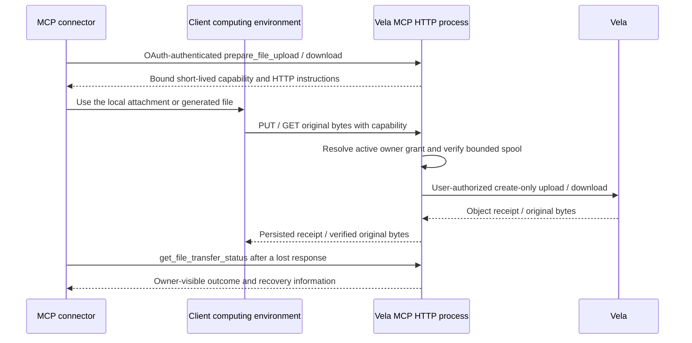

# HTTP file transfer

Implemented by the same process as MCP Streamable HTTP and local OAuth. The broker provides original-byte uploads/downloads without base64 in MCP tool arguments or a shared client/server filesystem. Configure HTTP transport and `transfers.enabled=true`; each preparation/status tool also has its own `[tools]` switch.

## Control plane and byte plane



MCP carries control requests, metadata and receipts. A computing environment carries file bytes through separate HTTP routes. OAuth/Vela credentials are not needed in that environment: a transfer capability authorizes one bound operation. Preparation results contain secrets; send them only to the advertised server origin and omit them from logs.

## Upload

`prepare_file_upload` requires an `rw` or `admin` key with access to the destination. Its arguments are:

| Field | Meaning |
| --- | --- |
| `path` | Logical Vela destination, normalized and scope/prefix checked |
| `size` | Exact original byte count; zero supports an empty file |
| `sha256` | Exactly 64 hexadecimal characters, computed over the original bytes |
| `metadata` | Visibility, title, description, tags, content type, disposition and expiry |

Metadata is validated during preparation. New files default to private, tags are normalized, and relative expiry becomes an absolute timestamp at that time. Preparation does not create a Vela file. Replacement is not supported by this capability; `replace_file` remains separately enabled with its required revision and bounded inline/local sources.

The result includes `transfer_id`, `upload_url`, `method="PUT"`, an authorization header in `headers`, `expires_at`, bound size/hash, and the configured byte limit. The endpoint is:

```text
PUT /transfers/uploads/{transfer_id}
Authorization: Bearer <short-lived upload capability>
Content-Type: application/octet-stream

<original raw bytes>
```

After computing size/hash and preparing the transfer through MCP, a client can stream its file with curl:

```bash
# Use values from the preparation result; these are transfer credentials,
# not the Vela API key or general OAuth access token.
curl --fail-with-body \
  --header "Authorization: Bearer $TRANSFER_CAPABILITY" \
  --header 'Content-Type: application/octet-stream' \
  --upload-file "$CLIENT_FILE" \
  "$UPLOAD_URL"
```

Redemption verifies the capability hash, expiry and active OAuth owner, atomically claims the single-use upload, and receives at most the bound size plus one verification byte. A private disk spool permits full size/SHA validation before any upstream mutation. The grant is checked again after reception; Vela independently verifies the hash and uses create-only semantics. Existing destinations are not overwritten.

Success returns HTTP 201 and a persisted object receipt. A malformed size/body/hash consumes the claimed capability and returns 422; fix the input and prepare a new transfer. Replays return 409. Expired transfers return 410; invalid capabilities or inactive grants return 401. Saturated concurrency returns 503 before claim, so the same unused grant can be retried. Upstream uploads are not automatically retried; failures record a failed or uncertain outcome rather than inferring success from identical existing bytes.

## Download

`prepare_file_download` accepts `path`. Read-only Vela authority is sufficient, including for private files. It snapshots the authorized object ID, path, revision, size and SHA-256, and returns `transfer_id`, `download_url`, `method="GET"`, expiry, filename, full object metadata and the use limit. Visibility remains unchanged; this is separate from `create_share_link`.

The browser-usable endpoint embeds a short-lived random capability:

```text
GET /transfers/downloads/{transfer_id}?token=<download capability>
```

```bash
curl --fail-with-body --output "$CLIENT_DESTINATION" "$DOWNLOAD_URL"
sha256sum "$CLIENT_DESTINATION"
# Compare with object.sha256 from prepare_file_download.
```

The server rechecks the owner's grant, validates the bound source revision, downloads through that owner's Vela key, and verifies the full representation in a private disk spool before returning bytes. A replaced, moved or otherwise changed object requires a new preparation. Source corruption is rejected before file bytes are sent.

GET and HEAD are supported, including byte Range, multipart Range and If-Range. Each request consumes one of 32 uses, even when requesting a small range or HEAD. Every use fetches and verifies the full upstream representation before serving a range; this prioritizes verified content over upstream partial-read efficiency. The URL expires independently of its use count and also becomes invalid if its owner's OAuth grant is revoked/expired.

Responses preserve arbitrary original bytes. They deliberately use `application/octet-stream`, attachment disposition, `nosniff`, `no-store` and restrictive CSP at the OAuth origin; the actual MIME type remains in the preparation metadata. `ETag` and `X-Content-SHA256` expose the verified digest. This prevents an uploaded HTML file from executing beside the authorization UI.

The client can process the downloaded PDF, image, archive, Office file, audio or other binary using its available tools and upload a resulting file to another create-only destination. To return a file to the user, use the host's native file-output mechanism if supported, or provide the expiring URL. The server cannot create a native conversation attachment on behalf of the host.

## Status and recovery

`get_file_transfer_status` accepts the opaque `transfer_id` and requires the same authenticated OAuth grant subject. It never returns capability secrets. Authorizing the same Vela key again creates another grant and does not grant access to prior transfer receipts.

| State | Meaning |
| --- | --- |
| `prepared` | Capability available and not yet successfully consumed |
| `uploading` | A single upload has been claimed; no other request can claim it |
| `succeeded` | Persisted upload receipt, or verified download bytes available for serving |
| `failed` | Claimed upload failed validation or received a definite upstream rejection |
| `uncertain` | Upload result cannot be established, including interrupted claims after restart |
| `expired` | Unused prepared capability has reached its expiry |

For uncertain uploads, the broker may observe destination metadata matching the bound size/hash and include it as recovery information. It keeps the result uncertain: another actor could have created identical content. Inspect metadata/revision before deciding whether to prepare another create-only upload. No automatic overwrite or blind replay occurs. A successful download does not prove a remote browser saved every byte; verify the client's size/hash.

Terminal/status records are retained for seven days and pruned during later preparation. Failed/revoked/expired capabilities do not become fresh authorization on restart. Private stale spool files are removed at startup.

## Limits and deployment

The broker stores only owner subjects, capability hashes, bound metadata and receipts in SQLite. Encrypted Vela credentials remain in OAuth storage and are looked up at every use. The application rechecks scope/prefix and receives no host filesystem capability.

Configured binary limits default to 256 MiB in each direction. Spooling uses constant memory and private temporary disk space beside the transfer database, with four concurrent transfers. A grant can have at most 64 pending prepared/uploading transfers. Default lifetime is 15 minutes; permitted configuration is one minute to one hour. HTTP/Vela timeouts and nginx body/time limits also apply.

Run one process per state directory. Publish a reachable HTTPS origin for cloud clients, proxy all paths unchanged, and redact capability query strings and bearer headers from logs. A connector connection does not automatically permit outbound requests from the client's computing environment; configure its domain/network policy and confirm behavior in the actual host. Native file interpretation and attachment size/type limits remain host-specific. See [deployment](deployment.md) for commands, nginx and operations.
